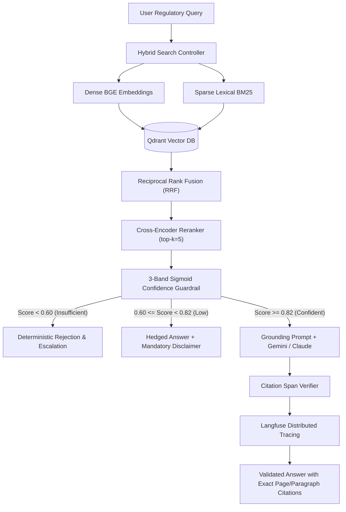
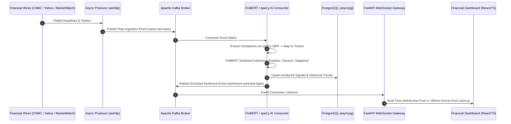
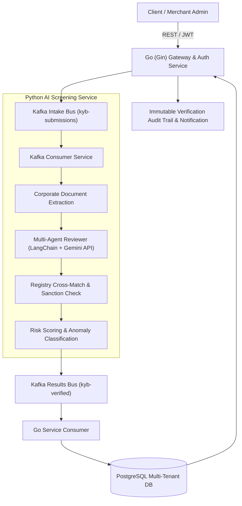

# Sultan Mehmood
### **ML Systems & Backend Engineer**
📍 *Dera Ghazi Khan / Islamabad, Pakistan* &nbsp;|&nbsp; 🎓 *BSCS @ COMSATS (3.52 CGPA | Top 10% | 93% HEC NCT)*

[+%26+Computer+Vision+Pipelines;BSCS+%40+COMSATS+(3.52+CGPA+%7C+Top+10%25+%7C+93%25+HEC+NCT))](https://git.io/typing-svg)

  
  
  

---

### 👨‍💻 Executive Engineering Summary

Computer Science student (**COMSATS University Islamabad**, Expected Jan 2027) and former **Software Engineering Intern at Neuronix Technologies**. 

Specialized in architecting and shipping production **identity-verification (KYB)**, **transaction-screening**, and **citation-grounded LLM systems**. Core engineering competencies include:
- **Event-Driven Microservices:** Asynchronous multi-service pipelines built with **Go (Gin)**, **Python (FastAPI)**, **Apache Kafka**, and **PostgreSQL (asyncpg / SQLAlchemy)**.
- **Applied Generative AI & Retrieval (RAG):** Citation-verified hybrid retrieval architectures combining dense embeddings (**BGE**) and sparse lexical search (**BM25**) with **Reciprocal Rank Fusion (RRF)** in **Qdrant**, strict confidence guardrails, **Langfuse** observability, and **Ragas** automated evaluation.
- **Explainable Machine Learning & Vision:** Diagnostic clinical risk assessment systems evaluated with **SHAP / LIME** feature attributions, and deepfake media verification pipelines with **PyTorch** and **OpenCV**.

---

## 🛠️ Categorized Technical Stack

### 💻 Core Languages

### 🧠 LLM, RAG & Agentic AI

-0F172A?style=for-the-badge&logo=search&logoColor=38BDF8)

### 📊 Machine Learning & Data Science

-09A3D5?style=for-the-badge&logo=spacy&logoColor=white)

### ⚙️ Backend, Distributed Systems & DevOps
-00ADD8?style=for-the-badge&logo=go&logoColor=white)

### 👁️ Computer Vision, Audio & Engineering Tooling

---

## 🏛️ Flagship Production & Enterprise Architecture Showcase

Below is a detailed inspection of production systems engineered across enterprise internships and advanced implementations:

### 1. Citerator — Citation-Verified AML/KYC Compliance RAG Platform
**Repository:** [github.com/sultanriaz/citerator](https://github.com/sultanriaz/citerator) &nbsp;|&nbsp; **Stack:** Python (FastAPI), Qdrant, BGE Embeddings, BM25, Cross-Encoder Reranking, Langfuse, Ragas

> **System Purpose:** Enterprise Question-Answering engine built for AML/KYC compliance officers to query dense regulatory corpuses with cryptographically verifiable source chunk citations and strict zero-hallucination refusal guarantees.

- **Retrieval Pipeline:** Dense vector search (BAAI/bge-small-en-v1.5) and sparse BM25 retrieval fused via **Reciprocal Rank Fusion (RRF)** in Qdrant, followed by cross-encoder re-ranking.
- **Confidence Guardrails:** 3-band sigmoid confidence mechanism (`confident` $\ge 0.82$, `low_confidence` $0.60 \le s < 0.82$, `insufficient` $< 0.60$) ensuring out-of-corpus questions are deterministically refused.
- **Ragas Benchmark Results:**
  - **Mean Faithfulness:** `0.97` across test batches.
  - **Refusal Accuracy:** `100%` on adversarial out-of-domain compliance inquiries.
  - **Telemetry:** Complete step-by-step latency, token cost, and retrieval score tracing logged to **Langfuse**.

---

### 2. Real-Time Financial AI Intelligence Platform
**Repository:** [github.com/sultanriaz/financial-ai-platform](https://github.com/sultanriaz/financial-ai-platform) &nbsp;|&nbsp; **Stack:** Python (FastAPI), Apache Kafka, PyTorch, HuggingFace FinBERT, spaCy NER, asyncpg, PostgreSQL, WebSockets

> **System Purpose:** Distributed sub-second streaming engine ingesting financial news headlines from major market wires, resolving named entity tickers, computing financial sentiment vectors, and broadcasting actionable insights via persistent WebSockets.

- **Ingestion & Resolution:** Concurrent asynchronous polling of news wires; automated mapping of corporate entity names to standard market tickers using customized **spaCy NER**.
- **Inference Pipeline:** Domain-adapted **ProsusAI/finbert** transformer models running batched GPU/CPU tensor inference to generate directional sentiment polarity and confidence scores.
- **Distribution:** Real-time event broadcasting over asynchronous WebSocket channels with sub-second end-to-end latency and indexed persistence in PostgreSQL via **asyncpg**.

---

### 3. NeuroVerify KYB & Transaction Screening Modules (Neuronix Technologies)
**Engineering Context:** Software Engineering Internship at Neuronix Technologies &nbsp;|&nbsp; **Stack:** Go (Gin), Python (FastAPI), Apache Kafka, PostgreSQL, Docker Compose, Google Gemini, LangChain, JWT

> **System Purpose:** Multi-service business identity verification (KYB) and transaction risk screening architecture automating commercial registry cross-referencing and AML compliance checks.

- **Dual-Engine Microservices:** High-throughput intake routing and JWT security enforcement written in **Go (Gin)**; AI agentic document comprehension and semantic extraction implemented in **Python (FastAPI)**.
- **Agentic Registry Matching:** **Google Gemini API** orchestrated with **LangChain** for corporate registration document parsing, UBO (Ultimate Beneficial Owner) discovery, and sanction list verification.
- **Isolation & Deployment:** Strict multi-tenant row-level authorization boundaries; complete containerized topology orchestrated via **Docker Compose**.

---

## 🔬 Featured Public Engineering Repositories

<table align="center" width="100%">
  <thead>
    <tr>
      <th width="32%">Repository & Focus</th>
      <th width="48%">System Architecture & Problem Statement</th>
      <th width="20%">Key Technologies</th>
    </tr>
  </thead>
  <tbody>
    <tr>
      <td>
        <b><a href="https://github.com/sultanriaz/citerator">citerator</a></b> 
        Citation-Grounded AML RAG
      </td>
      <td>
        Enterprise hybrid RAG platform fusing dense BGE embeddings with sparse BM25 via Reciprocal Rank Fusion in Qdrant. Enforces strict three-band sigmoid confidence guardrails, Langfuse telemetry, and achieves 0.97 Ragas faithfulness.
      </td>
      <td>
        <code>FastAPI</code> <code>Qdrant</code> <code>LangChain</code> <code>BM25</code> <code>Langfuse</code> <code>Ragas</code>
      </td>
    </tr>
    <tr>
      <td>
        <b><a href="https://github.com/sultanriaz/financial-ai-platform">financial-ai-platform</a></b> 
        Real-Time Financial Intelligence
      </td>
      <td>
        Event-driven streaming intelligence pipeline consuming news headlines across financial wires, parsing corporate entities with spaCy NER, scoring sentiment with FinBERT, and streaming signals over WebSockets.
      </td>
      <td>
        <code>Apache Kafka</code> <code>FinBERT</code> <code>FastAPI</code> <code>spaCy</code> <code>WebSockets</code> <code>asyncpg</code>
      </td>
    </tr>
    <tr>
      <td>
        <b><a href="https://github.com/sultanriaz/Deepfake_detector">Deepfake_detector</a></b> 
        Computer Vision & Media Forensics
      </td>
      <td>
        Frame-level media authenticity verification pipeline. Automates facial bounding-box extraction with MTCNN, applies frame normalization, and performs deep neural binary classification to distinguish manipulated from authentic media.
      </td>
      <td>
        <code>PyTorch</code> <code>OpenCV</code> <code>MTCNN</code> <code>TorchVision</code> <code>Python</code>
      </td>
    </tr>
    <tr>
      <td>
        <b><a href="https://github.com/sultanriaz/Diabetes_detection">Diabetes_detection</a></b> 
        Explainable Clinical AI (XAI-CDSS)
      </td>
      <td>
        Healthcare decision support system combining Random Forest and XGBoost predictive models with feature-level SHAP summary plots and local LIME explanations, ensuring clinician interpretability for patient risk factors.
      </td>
      <td>
        <code>scikit-learn</code> <code>XGBoost</code> <code>SHAP</code> <code>LIME</code> <code>Flask</code> <code>Pandas</code>
      </td>
    </tr>
    <tr>
      <td>
        <b><a href="https://github.com/sultanriaz/Advance_QR_scanning_system">Advance_QR_scanning_system</a></b> 
        Heuristic Security & QR Analysis
      </td>
      <td>
        Security utility decoding QR payloads with OpenCV in real time, inspecting URL structures for spoofing heuristics (entropy, punycode, protocol verification), and maintaining an audited SQLite scan history.
      </td>
      <td>
        <code>OpenCV</code> <code>Python</code> <code>Flask</code> <code>SQLite</code> <code>Heuristic-Analysis</code>
      </td>
    </tr>
    <tr>
      <td>
        <b><a href="https://github.com/sultanriaz/tts-voice-recorder-python">tts-voice-recorder-python</a></b> 
        Multilingual Audio Synthesis & Recording
      </td>
      <td>
        Multi-interface audio processing toolkit supporting CLI, Tkinter GUI, and Flask web surfaces. Provides online (gTTS) and offline (pyttsx3) synthesis with dedicated Urdu phoneme handling and PyAudio WAV/MP3 recording.
      </td>
      <td>
        <code>gTTS</code> <code>pyttsx3</code> <code>PyAudio</code> <code>Flask</code> <code>Tkinter</code>
      </td>
    </tr>
  </tbody>
</table>

---

## 📈 Engineering Activity & GitHub Metrics

  
  

  

---

## 📬 Contact & Engineering Collaboration

- **Email:** [khansultanriaz@gmail.com](mailto:khansultanriaz@gmail.com)
- **LinkedIn:** [linkedin.com/in/sultan-riaz](https://linkedin.com/in/sultan-riaz)
- **GitHub:** [github.com/sultanriaz](https://github.com/sultanriaz)
- **Location:** Dera Ghazi Khan / Islamabad, Pakistan
