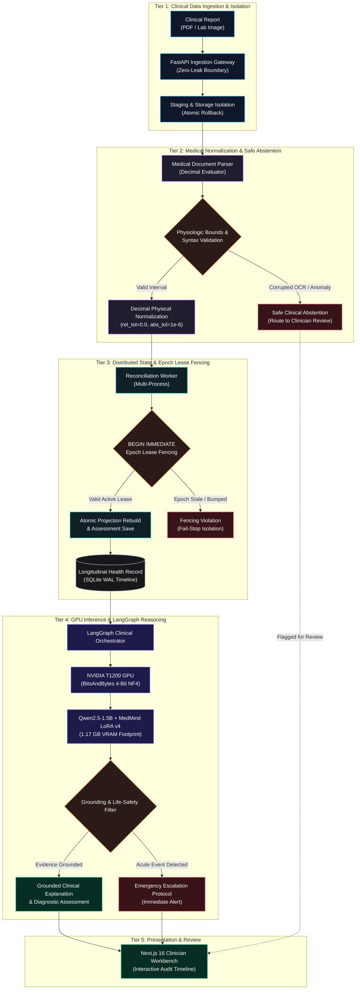
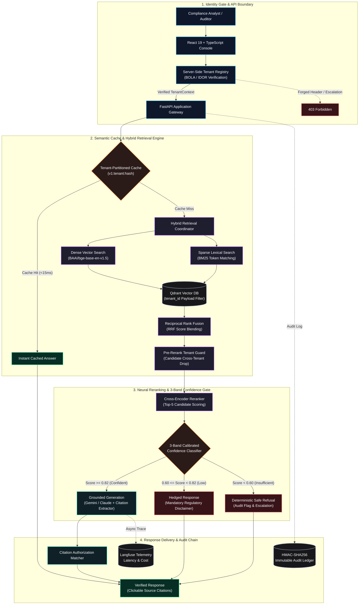
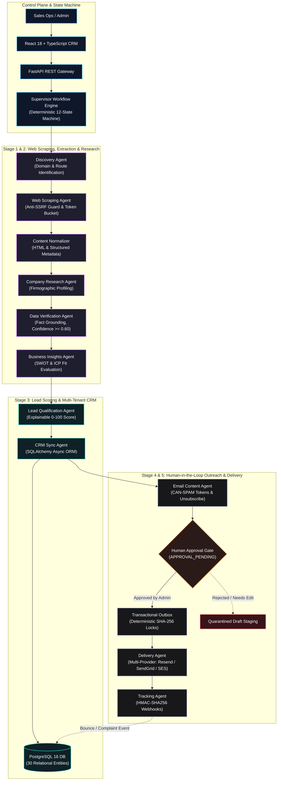
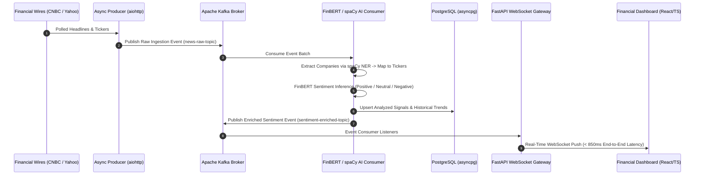
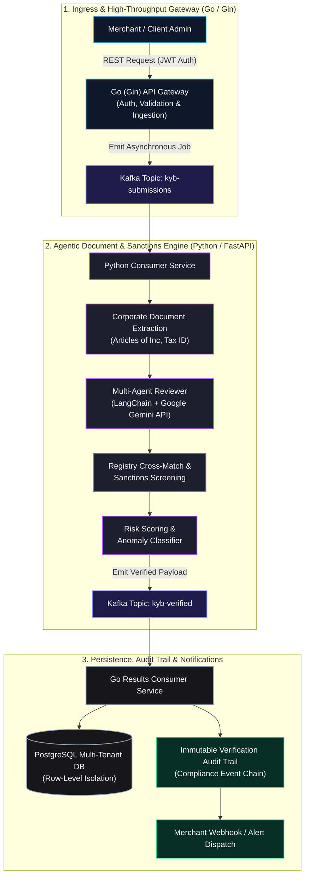

<div align="center">

# Sultan Mehmood
### **AI Systems, Backend Engineering & Distributed Architectures**
📍 *Dera Ghazi Khan / Islamabad, Pakistan* &nbsp;|&nbsp; 🎓 *BSCS @ COMSATS University Islamabad (3.52 CGPA | Top 10% | 93% HEC NCT)*

[;Architecting+Citation-Verified+Hybrid+RAG+%26+Multi-Agent+Systems;Accelerating+Local+LLMs+with+4-Bit+CUDA+Quantization+(BitsAndBytes);BSCS+%40+COMSATS+(3.52+CGPA+%7C+Top+10%25+%7C+93%25+HEC+Competency))](https://git.io/typing-svg)

<p align="center">
  <a href="mailto:khansultanriaz@gmail.com">
    
  </a>
  <a href="https://linkedin.com/in/sultan-mehmood-5205562b8">
    
  </a>
  <a href="https://github.com/sultanriaz">
    
  </a>
</p>

</div>

---

### 👨‍💻 Executive Engineering Summary

Computer Science student at **COMSATS University Islamabad** (Expected January 2027) and active **Software Engineering Intern at Neuronix Technologies** (Summer 2026 – Present | Hybrid).

Specialized in architecting and shipping production-grade **event-driven backends**, **citation-verified RAG systems**, and **hardware-accelerated generative intelligence**. Core engineering focus areas include:

- **Event-Driven Distributed Systems & Concurrency:** High-throughput microservice architectures and transactional workflows built with **Go (Gin)**, **Python (FastAPI)**, **Apache Kafka**, and **PostgreSQL / SQLite** with multi-process epoch lease fencing.
- **Applied Generative AI & Retrieval (RAG):** Citation-verified hybrid retrieval architectures combining dense embeddings (**BGE**) and sparse lexical search (**BM25**) with **Reciprocal Rank Fusion (RRF)** in **Qdrant**, strict confidence guardrails, **Langfuse** telemetry, and **Ragas** automated evaluation.
- **Hardware-Accelerated LLMs & Diagnostic Intelligence:** Enterprise clinical decision support systems, **NVIDIA T1200 4-bit CUDA GPU** hardware acceleration, fine-tuned **LoRA v4** generative reasoning with **LangGraph**, Decimal physical quantity evaluation (zero-tolerance), and **SHAP / LIME** model interpretability.

---

## 🛠️ Categorized Technical Stack

### 💻 Core Languages


### 🧠 LLM, RAG & Agentic Systems


-1E293B?style=for-the-badge&logo=databricks&logoColor=white)


-0F172A?style=for-the-badge&logo=search&logoColor=38BDF8)


### ⚙️ Backend, Distributed Systems & Infrastructure
-00ADD8?style=for-the-badge&logo=go&logoColor=white)


### 📊 Machine Learning & Data Science


-09A3D5?style=for-the-badge&logo=spacy&logoColor=white)


### 👁️ Frontend, Tooling & Computer Vision


---

## 🏛️ Flagship Production & Enterprise Architecture Showcase

Below is an in-depth inspection of flagship architectures engineered across enterprise internships and advanced technical implementations:

---

### 1. MedMind — Clinical Diagnostic Intelligence & Longitudinal Record Engine
**Repository:** [github.com/sultanriaz/FYP-Medmind](https://github.com/sultanriaz/FYP-Medmind) &nbsp;|&nbsp; **Stack:** Python (FastAPI), PyTorch (CUDA 12.1), Transformers & PEFT (MedMind LoRA v4), BitsAndBytes (4-bit NF4 Quantization), LangGraph Orchestrator, Next.js 16 (React 19, TypeScript), SQLite Concurrency (WAL + Multi-Process Epoch Lease Fencing), Decimal Physics Evaluator

> **System Purpose:** Enterprise clinical diagnostic intelligence, fine-tuned medical reasoning, and longitudinal health record engine engineered under strict healthcare data-safety standards. Features fine-tuned MedMind LoRA v4 accelerated via 4-bit NF4 quantization on an NVIDIA T1200 GPU, multi-stage LangGraph clinical reasoning, zero-leak upload boundaries, multi-process distributed epoch lease fencing (`BEGIN IMMEDIATE`, monotonic lease bumping, fail-stop isolation), zero-tolerance Decimal physical quantity evaluation, and safe clinical abstention on corrupted OCR values.



#### Key Engineering Highlights:
- **Trained LoRA v4 & Hardware Acceleration:** Quantized fine-tuned Qwen2.5-1.5B (`MedMind LoRA v4`) with `bitsandbytes` NF4 onto an **NVIDIA T1200 Laptop GPU** (4 GB VRAM, Turing cc 7.5, PyTorch CUDA 12.1). Reduced model memory footprint to **1,169.57 MB VRAM** (28.5% utilization), achieving 100% generative model primacy with 0% silent fallbacks across the 30-case clinical evaluation matrix.
- **LangGraph Clinical Reasoning & Balanced Safety:** Orchestrated multi-stage dynamic retrieval, numerical grounding, reflection, and context-aware emergency safety routing. Enforces strict ADA diagnostic criteria ($\ge 126\text{ mg/dL}$ fasting glucose) and instantaneous emergency escalation for acute events (anaphylaxis, stroke, severe hyperkalemia, severe thrombocytopenia).
- **Multi-Process Concurrency Safety:** Connection-level SQLite epoch lease fencing across longitudinal projections and clinical assessment write paths. Validated under genuine subprocess `SIGKILL` termination, mid-rebuild recovery, and monotonic epoch bumping with 0 cross-patient state leakage.
- **Strict Clinical Evaluator v2.0:** Dual-engine evaluation (Validated Decimal Physics & Strict Bipartite Matching) operating at zero tolerance (`rel_tol=0.0, abs_tol=1e-6`). Enforces safe clinical abstention rather than heuristic guessing when OCR boundaries are corrupted.
- **Verified Clinical Corpus & Quality Gates:** **309/309 full backend test suite passing (100%)**, 102/102 clinical corpus cases verified (186/186 measurements matched strictly), 30/30 GPU clinical evaluation matrix passed with zero degradations, 17/17 live negative upload tests with zero DB/filesystem orphan leaks, and dynamic SQL tracing reducing query counts by 99.6% at scale ($N=500$).

<details>
<summary><b>Explore Deep-Dive Concurrency & Fail-Stop Architecture</b></summary>

```text
CONCURRENCY & FAIL-STOP LEASE FENCING SPECIFICATION:
1. Ingestion Isolation: Uploads staged atomically; uncommitted files cleaned on rollback (0 orphan leaks).
2. Epoch Leases: Every projection rebuild worker obtains an epoch lease fenced by `BEGIN IMMEDIATE`.
3. Dead-Worker Recovery: Stale leases (heartbeat > threshold) preempted through monotonic epoch increment.
4. Fail-Stop Isolation: Any write attempt by a superseded worker raises FencingViolationError and halts immediately.
5. Physics Evaluation: Zero-tolerance Decimal parsing preserves raw laboratory significance and unit parity.
```
</details>

---

### 2. Citerator — Citation-Verified AML/KYC Compliance RAG Platform
**Repository:** [github.com/sultanriaz/citerator](https://github.com/sultanriaz/citerator) &nbsp;|&nbsp; **Stack:** Python (FastAPI), React 19 (TypeScript), Qdrant (Dense + BM25 Hybrid), BGE Embeddings, Cross-Encoder Reranking, Multi-Tenant BOLA/IDOR Security, Langfuse, Ragas, HMAC Audit Ledger

> **System Purpose:** Enterprise Question-Answering and regulatory research engine engineered for AML/KYC compliance analysts. Features cryptographically verifiable source citations, strict default-deny multi-tenant isolation, cross-tenant leak prevention at retrieval/rerank/citation layers, EU AI Act / ISO 42001 compliance controls, and calibrated zero-hallucination refusal guarantees.



#### Key Engineering Highlights:
- **Retrieval Pipeline & Hybrid Indexing:** Dense vector search (`BAAI/bge-base-en-v1.5`) and sparse lexical BM25 fused via **Reciprocal Rank Fusion (RRF)** in Qdrant, followed by cross-encoder neural reranking.
- **Multi-Tenant Security & BOLA/IDOR Defense:** Server-side tenant registry preventing forged `X-Tenant-Id` / `X-User-Role` headers, mandatory Qdrant payload filters during HNSW walk, pre-rerank candidate drop guards, citation resolution tenant authorization, and tenant-partitioned semantic cache namespaces (`v1:<tenant_id>:<hash>`).
- **Confidence Guardrails & Safe Abstention:** 3-band calibrated sigmoid confidence mechanism (`confident` $\ge 0.82$, `low_confidence` $0.60 \le s < 0.82$, `insufficient` $< 0.60$) ensuring out-of-corpus questions are deterministically refused with escalation drafts.
- **Regulatory Governance & Audit Chain:** EU AI Act (Art. 12/14/15) and ISO 42001 automated compliance checks, forward-linked HMAC SHA-256 audit ledger, and GDPR Article 17 right-to-erasure scanning engine.
- **Ragas Benchmark Results & Observability:**
  - **Mean Faithfulness:** `0.97` across test batches.
  - **Refusal Accuracy:** `100%` on adversarial out-of-domain compliance inquiries.
  - **Telemetry:** End-to-end token cost, retrieval latency, and score telemetry traced to **Langfuse**.

<details>
<summary><b>Explore Multi-Tenant Security Boundaries & Calibration Thresholds</b></summary>

```text
5-LAYER DEFENSE-IN-DEPTH BOUNDARY MATRIX:
Boundary 1 (Identity Gate): API Key maps to Verified TenantContext; rejects forged headers.
Boundary 2 (Scoped Cache): Semantic cache key incorporates hash of tenant ID and query string.
Boundary 3 (HNSW Walk): Vector search enforces tenant_id payload filter at the index level.
Boundary 4 (Pre-Rerank): Any retrieved chunk belonging to another tenant is dropped before reranker context.
Boundary 5 (Citation Authorizer): Clickable source citations verified against tenant permissions before rendering.
```
</details>

---

### 3. Company Intelligence CRM — Autonomous Multi-Agent Research & Outreach Platform
**Repository:** [github.com/sultanriaz/company-intelligence-crm](https://github.com/sultanriaz/company-intelligence-crm) &nbsp;|&nbsp; **Stack:** Python (FastAPI), React 18 (TypeScript), PostgreSQL 16 (SQLAlchemy 2.x Async), Celery, Redis, Anti-SSRF Crawler, Playwright, Transactional Outbox, AES-256-GCM, HMAC-SHA256, Tailwind CSS

> **System Purpose:** Enterprise-grade multi-agent platform designed to discover companies, crawl and parse corporate websites with defense-in-depth scrapers, synthesize company intelligence, automatically qualify sales leads, manage relationships via a custom CRM, and execute compliant, personalized outbound email campaigns with human-in-the-loop review and transactional outbox guarantees.



#### Key Engineering Highlights:
- **11-Agent State Machine & Deterministic Ownership:** Autonomous execution through 12 formal states (`CREATED` ➔ `DISCOVERING` ➔ `EXTRACTING` ➔ `RESEARCHING` ➔ `VERIFYING` ➔ `ANALYZING` ➔ `SAVING` ➔ `EMAIL_PREPARATION` ➔ `APPROVAL_PENDING` ➔ `SENDING` ➔ `COMPLETED`). Deterministic Python code owns all database transactions, rate limits, outbox dispatches, and budget enforcement ($2.00 max cost, 300s timeout guardrails).
- **Anti-SSRF Web Security & Scraping Engine:** Hardened web crawling infrastructure enforcing pre-flight DNS checks against RFC 1918 subnets, IPv6 loopbacks, link-local IPs, and cloud metadata services (`169.254.169.254`, `metadata.google.internal`), coupled with custom HTTPX per-redirect validation hooks and robots.txt caching.
- **Custom Multi-Tenant CRM Engine:** 30 relational entities declared in SQLAlchemy 2.x async ORM with `lazy="selectin"` eager loading, automated Alembic migrations, explainable multi-dimensional lead scoring (0–100), and interactive Kanban pipeline management.
- **Transactional Outbox & Delivery Safeguards:** Double-send idempotency locks generated via deterministic SHA-256 keys, human approval gates (`APPROVAL_PENDING`), automatic CAN-SPAM physical postal address and unsubscribe token injection, and HMAC-SHA256 authenticated provider webhooks with instant bounce/complaint suppression.
- **Automated Test Suite & Quality Gates:** **37/37 automated tests passing (100%)** across unit, integration, and full end-to-end acceptance scenarios, with a zero-warning React 18 production build (`tsc && vite build`).

<details>
<summary><b>Explore 12-State Supervisor Engine & Security Guardrails</b></summary>

```text
SUPERVISOR STATE MACHINE & SECURITY POLICY:
1. Deterministic Control: LLM agents produce structured JSON; code governs transition logic.
2. Anti-SSRF Defense: Pre-flight DNS validation prevents requests to internal RFC 1918 ranges.
3. Human-in-the-Loop: Outbound dispatches strictly held in APPROVAL_PENDING until authenticated admin action.
4. Outbox Idempotency: Delivery keys hashed from (campaign_id, lead_id, timestamp_bucket).
5. Budget Enforcement: Token expenditure tracked continuously; execution aborts if task exceeds $2.00.
```
</details>

---

### 4. Real-Time Financial AI Intelligence Platform
**Repository:** [github.com/sultanriaz/financial-ai-platform](https://github.com/sultanriaz/financial-ai-platform) &nbsp;|&nbsp; **Stack:** Python (FastAPI), Apache Kafka, PyTorch, HuggingFace FinBERT, spaCy NER, asyncpg, PostgreSQL, WebSockets, React 19

> **System Purpose:** Distributed sub-second streaming engine ingesting financial news headlines from major market wires, resolving named entity tickers, computing financial sentiment vectors with FinBERT, and broadcasting actionable insights via persistent WebSockets.

```mermaid
flowchart LR
    %% --- INGESTION TIER ---
    subgraph Ingestion["1. Async Ingestion Layer"]
        Wires["Financial News Feeds<br/>(CNBC, Yahoo, MarketWatch)"] --> Producer["Async Ingestion Worker<br/>(aiohttp Poller)"]
    end

    %% --- MESSAGE BROKER ---
    subgraph Broker["2. Distributed Event Streaming (Kafka)"]
        Producer -->|"Publish Raw Headlines"| RawTopic["Topic: news-raw-topic"]
        RawTopic --> WorkerConsumer["Batch Consumer Pool"]
        EnrichedTopic["Topic: sentiment-enriched-topic"]
    end

    %% --- NLP & INFERENCE ---
    subgraph Inference["3. NLP & Transformer Inference Engine"]
        WorkerConsumer --> NER["Entity Resolution<br/>(Custom spaCy NER)"]
        NER -->|"Resolved Tickers"| FinBERT["Sentiment Inference<br/>(ProsusAI / FinBERT)"]
        FinBERT -->|"Store Aggregated Signals"| DB[("PostgreSQL Database<br/>(asyncpg Driver)")]
        FinBERT -->|"Publish Enriched Event"| EnrichedTopic
    end

    %% --- DISTRIBUTION & DASHBOARD ---
    subgraph Distribution["4. Real-Time Push & UI"]
        EnrichedTopic --> WSGateway["FastAPI WebSocket Gateway<br/>(Consumer Listeners)"]
        WSGateway -->|"Sub-850ms Live Stream"| Dashboard["React + TypeScript Dashboard<br/>(Live Sentiment Radar)"]
    end

    %% Styling
    classDef ingest fill:#0f172a,stroke:#38bdf8,stroke-width:1.5px,color:#f8fafc;
    classDef kafka fill:#1e1b4b,stroke:#818cf8,stroke-width:1.5px,color:#f8fafc;
    classDef ai fill:#1e1e2e,stroke:#a855f7,stroke-width:1.5px,color:#f8fafc;
    classDef storage fill:#18181b,stroke:#94a3b8,stroke-width:1.5px,color:#f8fafc;
    classDef ui fill:#062e24,stroke:#34d399,stroke-width:1.5px,color:#f8fafc;

    class Wires,Producer ingest;
    class RawTopic,WorkerConsumer,EnrichedTopic kafka;
    class NER,FinBERT ai;
    class DB storage;
    class WSGateway,Dashboard ui;
```



#### Key Engineering Highlights:
- **Ingestion & Resolution:** Concurrent asynchronous polling of news wires; automated mapping of corporate entity names to standard market tickers using customized **spaCy NER**.
- **Inference Pipeline:** Domain-adapted **ProsusAI/finbert** transformer models running batched GPU/CPU tensor inference to generate directional sentiment polarity and confidence scores.
- **Distribution:** Real-time event broadcasting over asynchronous WebSocket channels with sub-second end-to-end latency (< 850ms) and indexed persistence in PostgreSQL via **asyncpg**.

<details>
<summary><b>Explore End-to-End Streaming Sequence & Message Contracts</b></summary>


</details>

---

### 5. NeuroVerify KYB & Transaction Screening Modules (Neuronix Technologies)
**Engineering Context:** Software Engineering Internship at Neuronix Technologies &nbsp;|&nbsp; **Stack:** Go (Gin), Python (FastAPI), Apache Kafka, PostgreSQL, Docker Compose, Google Gemini, LangChain, JWT

> **System Purpose:** Multi-service business identity verification (KYB) and transaction risk screening architecture automating commercial registry cross-referencing and AML compliance checks. Built with a dual Go/Python architecture linked by Apache Kafka event streaming.



#### Key Engineering Highlights:
- **Dual-Engine Microservices:** High-throughput intake routing and JWT security enforcement written in **Go (Gin)**; AI agentic document comprehension and semantic extraction implemented in **Python (FastAPI)**.
- **Agentic Registry Matching:** **Google Gemini API** orchestrated with **LangChain** for corporate registration document parsing, UBO (Ultimate Beneficial Owner) discovery, and sanction list verification.
- **Isolation & Deployment:** Strict multi-tenant row-level authorization boundaries; complete containerized topology orchestrated via **Docker Compose**.

<details>
<summary><b>Explore Dual-Engine Service Decoupling & Security Boundaries</b></summary>

```text
MICROSERVICES INTEGRATION CONTRACT:
1. Gateway Isolation: Go/Gin handles TLS termination, JWT validation, and client request rate limiting.
2. Decoupled Processing: Heavy OCR and LLM verification jobs dispatched asynchronously over Kafka.
3. Multi-Tenant Storage: PostgreSQL enforces strict tenant isolation on company registration records.
4. Non-Disclosure & Compliance: Internal production URLs, proprietary screening endpoints, and private merchant data are protected and excluded from public documentation.
```
</details>

---

## 🔬 Featured Engineering Repositories

<table align="center" width="100%">
  <thead>
    <tr>
      <th width="30%">Repository & Focus</th>
      <th width="50%">System Architecture & Problem Statement</th>
      <th width="20%">Key Technologies</th>
    </tr>
  </thead>
  <tbody>
    <tr>
      <td>
        <b><a href="https://github.com/sultanriaz/FYP-Medmind">FYP-Medmind</a></b><br/>
        <sub>Clinical Diagnostic & AI Reasoning Engine</sub>
      </td>
      <td>
        Enterprise clinical diagnostic platform powered by fine-tuned MedMind LoRA v4 accelerated on NVIDIA T1200 4-bit CUDA GPU. Features LangGraph clinical reasoning, multi-process SQLite epoch lease fencing, Decimal physical quantity evaluation, and 309/309 passing tests.
      </td>
      <td>
        <code>FastAPI</code> <code>PyTorch CUDA</code> <code>LangGraph</code> <code>BitsAndBytes NF4</code> <code>Next.js 16</code> <code>SQLite Concurrency</code>
      </td>
    </tr>
    <tr>
      <td>
        <b><a href="https://github.com/sultanriaz/citerator">citerator</a></b><br/>
        <sub>Citation-Grounded AML RAG</sub>
      </td>
      <td>
        Enterprise hybrid RAG platform fusing dense BGE embeddings with sparse BM25 via Reciprocal Rank Fusion in Qdrant. Enforces strict three-band sigmoid confidence guardrails, Langfuse telemetry, and achieves 0.97 Ragas faithfulness.
      </td>
      <td>
        <code>FastAPI</code> <code>Qdrant</code> <code>LangChain</code> <code>BM25</code> <code>Langfuse</code> <code>Ragas</code>
      </td>
    </tr>
    <tr>
      <td>
        <b><a href="https://github.com/sultanriaz/company-intelligence-crm">company-intelligence-crm</a></b><br/>
        <sub>Multi-Agent CRM & Outreach Engine</sub>
      </td>
      <td>
        Autonomous multi-agent company intelligence platform coordinating 11 specialist agents through a deterministic 12-state machine. Features an anti-SSRF crawler, 30-entity relational CRM, and transactional outbox with double-send idempotency locks.
      </td>
      <td>
        <code>FastAPI</code> <code>React 18</code> <code>PostgreSQL</code> <code>SQLAlchemy 2.x</code> <code>Celery</code> <code>Redis</code>
      </td>
    </tr>
    <tr>
      <td>
        <b><a href="https://github.com/sultanriaz/financial-ai-platform">financial-ai-platform</a></b><br/>
        <sub>Real-Time Financial Intelligence</sub>
      </td>
      <td>
        Event-driven streaming intelligence pipeline consuming news headlines across financial wires, parsing corporate entities with spaCy NER, scoring sentiment with FinBERT, and streaming signals over WebSockets.
      </td>
      <td>
        <code>Apache Kafka</code> <code>FinBERT</code> <code>FastAPI</code> <code>spaCy</code> <code>WebSockets</code> <code>asyncpg</code>
      </td>
    </tr>
    <tr>
      <td>
        <b><a href="https://github.com/sultanriaz/Deepfake_detector">Deepfake_detector</a></b><br/>
        <sub>Computer Vision & Media Forensics</sub>
      </td>
      <td>
        Frame-level media authenticity verification pipeline. Automates facial bounding-box extraction with MTCNN, applies frame normalization, and performs deep neural binary classification to distinguish manipulated from authentic media.
      </td>
      <td>
        <code>PyTorch</code> <code>OpenCV</code> <code>MTCNN</code> <code>TorchVision</code> <code>Python</code>
      </td>
    </tr>
    <tr>
      <td>
        <b><a href="https://github.com/sultanriaz/Diabetes_detection">Diabetes_detection</a></b><br/>
        <sub>Explainable Clinical AI (XAI-CDSS)</sub>
      </td>
      <td>
        Healthcare decision support system combining Random Forest and XGBoost predictive models with feature-level SHAP summary plots and local LIME explanations, ensuring clinician interpretability for patient risk factors.
      </td>
      <td>
        <code>scikit-learn</code> <code>XGBoost</code> <code>SHAP</code> <code>LIME</code> <code>Flask</code> <code>Pandas</code>
      </td>
    </tr>
    <tr>
      <td>
        <b><a href="https://github.com/sultanriaz/Advance_QR_scanning_system">Advance_QR_scanning_system</a></b><br/>
        <sub>Heuristic Security & QR Analysis</sub>
      </td>
      <td>
        Security utility decoding QR payloads with OpenCV in real time, inspecting URL structures for spoofing heuristics (entropy, punycode, protocol verification), and maintaining an audited SQLite scan history.
      </td>
      <td>
        <code>OpenCV</code> <code>Python</code> <code>Flask</code> <code>SQLite</code> <code>Heuristic-Analysis</code>
      </td>
    </tr>
    <tr>
      <td>
        <b><a href="https://github.com/sultanriaz/tts-voice-recorder-python">tts-voice-recorder-python</a></b><br/>
        <sub>Multilingual Audio Synthesis & Recording</sub>
      </td>
      <td>
        Multi-interface audio processing toolkit supporting CLI, Tkinter GUI, and Flask web surfaces. Provides online (gTTS) and offline (pyttsx3) synthesis with dedicated Urdu phoneme handling and PyAudio WAV/MP3 recording.
      </td>
      <td>
        <code>gTTS</code> <code>pyttsx3</code> <code>PyAudio</code> <code>Flask</code> <code>Tkinter</code>
      </td>
    </tr>
  </tbody>
</table>

---

## 📈 Engineering Activity & GitHub Metrics

<div align="center">
  
  
</div>

<div align="center">
  
</div>

---

## 📬 Contact & Engineering Collaboration

- **Email:** [khansultanriaz@gmail.com](mailto:khansultanriaz@gmail.com)
- **LinkedIn:** [linkedin.com/in/sultan-mehmood-5205562b8](https://linkedin.com/in/sultan-mehmood-5205562b8)
- **GitHub:** [github.com/sultanriaz](https://github.com/sultanriaz)
- **Location:** Dera Ghazi Khan / Islamabad, Pakistan
